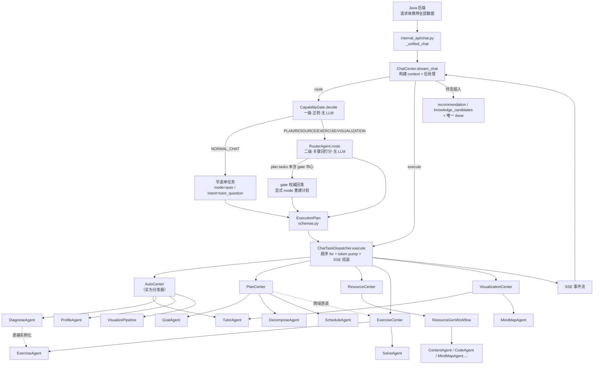

# Agent 路由与编排架构审计报告（只读调查）

> **性质**：静态调查（read-only）。**不含**任何重构建议、代码改动、参数调整。
> **范围**：对话路由 / 编排 / 产物生成的状态流转。**不做** Java 侧 DB 深审。
> **基准**：HEAD `24dd24d`；9 个路由核心文件 SHA-256 与 Stage 0.2 基线一致。
> **产出人**：Coding Agent A（Python AI 服务）　**日期**：2026-10-13
> **证据口径**：每条结论均标注 `文件:行`。区分【已验证调用】【静态推断】【未确定】。

---

## 一、当前架构总览

请求自 Java 经 `internal_api` 进入，由 **ChatCenter 统管路由与执行**，经两级路由（CapabilityGate → RouterAgent）产出 `ExecutionPlan`，再由 **ChatTaskDispatcher** 顺序执行各 **Center**，Center 内部调用 **Agent** 产出结果，Dispatcher 负责 SSE 组装，ChatCenter 负责终态后处理（推荐/知识候选/多 done 收敛）。



**入口层**：
- `internal_api/chat.py::_unified_chat` — 自述"只做协议适配，业务编排全部在 ChatCenter"（`chat.py` 头部注释 + Task 3 收口）。`/api/chat`。
- `internal_api/tutor.py` — `/tutor/chat` → `_get_tutor_center().stream_chat(messages, student_profile)`。

---

## 二、Center / Agent 职责总表

### 2.1 Center 层（`app/centers/*.py`）

| 类 | 文件 | 名义角色 | **实际职责** | 归类 |
|---|---|---|---|---|
| ChatCenter | `chat_center.py` (501) | 中心 | 路由根 + **组合根**（构造 8 Agent/5 Center）+ **SSE 后处理**（推荐/知识候选）+ **审计发射** | 编排器（过载） |
| AutoCenter | `auto_center.py` (338) | 中心 | 自述"名字叫 AutoCenter，但它是分发器，不拥有独立业务流程"（1-7 行）；按 intent 分派 tutor/solve/diagnose/profile | **分发器**（命名误导） |
| PlanCenter | `plan_center.py` (811) | 中心 | 业务编排 + Agent 选择器 + **服务集合**（9 个端点方法）+ **跨域直调 ExerciseCenter** | 业务中心（过载） |
| ResourceCenter | `resource_center.py` (172) | 中心 | **InquiryService 前置澄清** + 唯一 `ResourceGenWorkflow.run()` 调用点 | 业务中心 + 编排 |
| ExerciseCenter | `exercise_center.py` (319) | 中心 | ExerciseAgent 编排 + **服务集合**（批改/分类/会话分析/仪表盘/画像富化/巩固/热身） | 业务中心（过载） |
| VisualizationCenter | `visualization_center.py` (150) | 中心 | visualize 前**内嵌 TutorAgent** + MindMapAgent + 知识图谱 | 业务中心 |
| GraphCenter | `graph_center.py` | 中心 | 知识图谱读写/更新 | 业务中心 |
| TutorCenter | `tutor_center.py` (96) | 中心 | TutorAgent 分片流 + 后台 ProfileAgent 画像提取 | 业务中心 |
| RouterAgent | `router_agent.py` (219) | 中心（错位） | **二级规则规划器**：关键词打分 → ExecutionPlan；自述"非 Center、非 LLM Agent" | **规则判定器** |
| ChatTaskDispatcher | `chat_task_dispatcher.py` (490) | 原 ResultAgent | 调度 + token pump + **SSE 组装** + **正文合成** | 分发器 + 呈现 |

> `app/centers/` 目录内**8 个**类名带 Center，但其中 **ChatCenter 是编排器、AutoCenter 是分发器**；`RouterAgent` 与 `ChatTaskDispatcher` 并非业务中心。

### 2.2 Agent 层（五类分类法）

| # | 类型定义 | 代表类 | 说明 |
|---|---|---|---|
| 1 | **真·LLM 决策/生成 Agent** | TutorAgent, ContentAgent, ExerciseAgent, SolveAgent, ProfileAgent, CodeAgent, MindMapAgent, ProjectAgent, InteractiveDiagramAgent, PathAgent, AnalysisAgent/CodeGeneratorAgent/ReviewAgent | 走 LangGraph/LLM，产出内容 |
| 2 | **单次模型调用封装** | GoalAgent, DecomposeAgent | 组 prompt → 一次 LLM → 解析 JSON |
| 3 | **纯规则判定器** | RouterAgent（关键词）、DiagnoseAgent（BKT）、AdjustmentAgent（规则）、CapabilityGate（正则·在 services/） | 无 LLM |
| 4 | **任务分发器** | ChatTaskDispatcher, AutoCenter | 无业务内容 |
| 5 | **普通业务 Service** | domain_classifier, next_action, plan_service, context_builder, summary_maintainer, inquiry_service … | 领域算法 |

**生产已装配 Agent（15 个 + 可视化 3 个 = 18）**：GoalAgent, DecomposeAgent, ScheduleAgent, AdjustmentAgent, DiagnoseAgent, ProfileAgent, ExerciseAgent, ContentAgent（均见 `chat_center.py:85-121`）；TutorAgent（tutor_center / visualization_center）；SolveAgent（exercise_center / auto_center）；PathAgent + ContentAgent（LearningPathWorkflow）；CodeAgent, MindMapAgent, ProjectAgent, InteractiveDiagramAgent（ResourceGenWorkflow）；AnalysisAgent, CodeGeneratorAgent, ReviewAgent（VisualizePipeline）。

**休眠 Agent（生产从未构造，6 个）**：FlashcardAgent（零外部引用）、ReadingAgent、ReflectionAgent、ImageAgent、ExerciseVariantAgent（仅测试）、LayeredExplainAgent（仅可选注入 + 测试）。

> **关键结论**：`DiagnoseAgent` 名字含 Agent，**实为规则 + BKT 判定器**（`diagnose_agent.py`），非 LLM 决策 Agent。

---

## 三、五条请求调用链（真实代码追踪）

### A. 普通答疑「什么是进程调度？」

```
POST /api/chat (_unified_chat)
 → ChatCenter.stream_chat  构建 context{messages,style,images,user_id,conversation_id}  [chat_center.py:312-319]
 → ChatCenter.route
    → CapabilityGate.decide：命中 _QUESTION_RE(什么/？) 且无能力证据 → NORMAL_CHAT  [capability_gate.py:178-198]
    → NORMAL_CHAT 早退：单 CenterTask(mode=auto, intent=tutor_question)  [chat_center.py:170-195]
      ※ 二级 RouterAgent 完全不运行
 → ChatCenter.execute → ChatTaskDispatcher.execute
 → mode=auto ∈ _ON_TOKEN_MODES → AutoCenter.execute(task, on_token)  [chat_task_dispatcher.py:353-355]
 → AutoCenter：intent 非 solve/diagnose/profile → _run_tutor
    → TutorAgent.run（ContextBuilder/SummaryMaintainer 装配待接线）+ _respond_node
       → domain_classifier 分类 → llm.chat_stream → current_on_token 逐字
    → _maybe_visualize（前置正则预筛，非阻塞）
 → Dispatcher：token pump 吐 token 帧；收尾 content(partial=True)
 → ChatCenter：done 前插入 recommendation + knowledge_candidates（10s 超时）  [chat_center.py:372-]
SSE：center_start → token* → content(partial) → center_end → content(finalize) → recommendation → knowledge_candidates → done
```

### B. 生成练习题「给我出5道进程调度选择题。」

```
 → ChatCenter.route → CapabilityGate.decide：命中 verb_count_exercise → EXERCISE(0.75)  [capability_gate.py:70-77]
 → 非 NORMAL_CHAT → RouterAgent.route → _keyword_route → exercise 任务
    → expected_center="exercise" 若未命中 → gate 权威回落，显式 mode="exercise" 重建  [chat_center.py:204-214]
 → Dispatcher：mode=exercise ∈ _ON_TOKEN_MODES → ExerciseCenter.execute(task, on_token)  [chat_task_dispatcher.py:353-355]
 → ExerciseAgent.run（3 节点图，结构化生成）→ _on_token 透传 → 逐题题面/答案片段
 → Dispatcher token pump → SSE；收尾 content(partial=True)
SSE：center_start → token* → content(partial) → center_end → content(finalize) → done
```
> 注：`ExerciseCenter` 路径**不经** InquiryService 澄清。

### C. 生成学习资源「帮我生成一份进程调度的学习讲义。」

```
 → ChatCenter.route → CapabilityGate.decide：命中 request_material → RESOURCE  [capability_gate.py:134-142]
 → RouterAgent → resource 任务；Dispatcher：mode=resource ∉ _ON_TOKEN_MODES → ResourceCenter.execute(task)  [chat_task_dispatcher.py:356]
 → ResourceCenter.execute
    → InquiryService.check 前置澄清：不清晰 → CenterResult(event_type="inquiry", agent="InquiryService")  [resource_center.py:37-54]
    → 清晰 → _run_generation（资源域唯一允许的 Workflow 调用点）  [resource_center.py:100-113]
       → ResourceGenWorkflow.run → Director 按 resource_type 选 ContentAgent/Code/MindMap/Project/InteractiveDiagram
       → ContentAgent（真·LLM）→ content_blocks
 → Dispatcher：未发 token → 收尾 content(partial=False) 为唯一正文载体  [chat_task_dispatcher.py:290-296]
SSE：center_start → center_end → content(finalize) → done
```

### D. 学习规划「根据我的基础制定一个学习计划。」

```
 → ChatCenter.route → CapabilityGate.decide：命中 make_plan → PLAN  [capability_gate.py:124-132]
 → RouterAgent → plan 任务（learning_path）→ Dispatcher：mode=plan ∉ _ON_TOKEN_MODES → PlanCenter.execute(task)  [chat_task_dispatcher.py:356]
 → PlanCenter.execute：intent≠adjust_plan → _run_new_plan → _generate_base_plan  [plan_center.py:43-83]
    → _generate_base_plan：全系统唯一按序执行 Goal→Decompose→Schedule 的位置
       （Goal 失败→默认；Decompose 失败→空 dict；Schedule 失败→raise PlanGenerationError）  [plan_center.py:85-148]
    → _enrich_steps_with_nodes：graph_service.load_skeleton + categorize_exercises LLM 回退  [plan_center.py:195-286]
 → CenterResult(event_type="plan", agent="GoalAgent+DecomposeAgent+ScheduleAgent")
SSE：center_start → center_end → content(finalize) → done
```

### E. 复合任务「先讲解进程调度，再出5道题。」

**【已验证·塌缩】** 该句含「讲解」→ 命中 `_QUESTION_RE`，且无 `_IMPERATIVE_RE`（帮我/给我/请）→
`CapabilityGate.decide` 返回 **NORMAL_CHAT**（`question_over_capability`）[capability_gate.py:187-192]。
→ 走早退单任务 → **只答疑，不产题**；「再出5道题」被静默丢弃。

**【静态推断·若进入二级】** 若句首带祈使（如"帮我先讲解…再出5道题"）→ 一级判 EXERCISE → RouterAgent `_keyword_route`
可产出多意图任务，按 `_CENTER_EXECUTION_ORDER={auto:1,visualization:2,resource:3,exercise:4,plan:5}` 排序，
`_MUTEX_GROUPS` 互斥消解、`_INTENT_PRIORITY` 平局，3+ 意图置 `needs_confirmation`。
→ Dispatcher **顺序 for 循环**执行 [chat_task_dispatcher.py:189-263]，任务间 `CENTER_DELAY_SECONDS` 间隔；
**每任务仅用 route 时固定的 `task.context`，上游结果不注入下游**（`aggregated.results` 只累积、不回喂）。

> **复合任务现状**：或塌缩为单答疑（无祈使），或为**独立任务顺序拼接**（有祈使），**非真正链式编排**。

---

## 四、职责归属实况

| 职责 | **事实归属** | 证据 |
|---|---|---|
| 请求级一级分发 | CapabilityGate（**唯一**） | 自述"一级请求级分发本模块是唯一拥有者" [capability_gate.py:14-18] |
| 意图→中心映射 | **多处重复** | `_KIND_TO_CENTER` [chat_center.py:46-51]；`_center_for` [chat_task_dispatcher.py:329-340]；`INTENT_CENTER_MAP`/`_CENTER_EXECUTION_ORDER`（intent_extractor） |
| ExecutionPlan 定义 | schemas.py（dataclass） | [schemas.py:16-28] |
| ExecutionPlan 生产 | RouterAgent | [router_agent.py] |
| 顺序执行 | ChatTaskDispatcher | [chat_task_dispatcher.py:189-263] |
| 业务流编排 | 各业务 Center（PlanCenter 独有 Goal→Decompose→Schedule） | [plan_center.py:85-148] |
| **上下文构建** | **Agent 层**（TutorAgent 用 ContextBuilder/SummaryMaintainer；AutoCenter._run_solve 自建 last-6-messages） | 三处各自为政；ContextBuilder 接线"待 Task 6" |
| SSE 事件格式 | `app/events/types.py`（传输层） | [types.py] StreamEventType(12) |
| SSE 事件**组装** | ChatTaskDispatcher | token pump / finalize / done |
| 终态后处理 | ChatCenter（推荐/知识候选/多 done 收敛） | [chat_center.py:372-] |
| 产物 ID/关系/生成状态/落库 | **不在 Python**（Java 契约：Python 只算不落库） | `internal_api/__init__.py` 零持久化声明 |

---

## 五、主要耦合点与证据

1. **跨域直调（过度耦合）**
   - `PlanCenter._exercise_center()` 惰性构造并调用 `ExerciseCenter`（complete_step / regression warmup）[plan_center.py:623-627]。
   - `DiagnoseAgent` **直接 import 并实例化 ExerciseAgent**：`from app.agents.exercise_agent import ExerciseAgent` [diagnose_agent.py:4]；`_generate_attempts` 调用之 [diagnose_agent.py:63]。
   - `VisualizationCenter` 内嵌 `TutorAgent` 生成前置内容 [visualization_center.py:44-59]。
   - `AutoCenter` 调用 `VisualizePipeline`（`_maybe_visualize`）。
   - **Agent→Agent 直调仅 1 处**（DiagnoseAgent→ExerciseAgent）；其余跨域调用均在 Center 层。

2. **逻辑重复**
   - 画像完整度校验：`AutoCenter._run_profile_building` 注释明示"与 ProfileWorkflow.completeness_check 节点逻辑一致"，且 `filled_dims >= 4` 硬编码 [auto_center.py:250 附近]。
   - 前置条件/开放步骤：`next_action.py` 与 `GraphService.check_prerequisites` + `learning_snapshot._open_steps` 重复。
   - mode↔kind↔center 映射：`_MODE_TO_KIND`（gate）与 `MODE_TO_INTENT`（RouterAgent）、`_KIND_TO_CENTER`、`_center_for`、`INTENT_CENTER_MAP` **≥5 张表**。

3. **职责混合**
   - `ChatTaskDispatcher`：调度 + SSE 组装 + 正文合成（`_summarize_product` / `_ensure_user_visible_response` / `_build_summary` / `_build_next_steps` / `_finalize_event`）。
   - `ChatCenter`：路由根 + 组合根（构造 13 个组件）+ SSE 后处理 + 审计发射 [chat_center.py:85-121, 242-252]。
   - 业务 Center（Plan/Exercise）= 业务编排 + Agent 选择器 + 服务集合。

4. **契约问题**
   - Agent I/O 为**无类型 dict**：`state["questions"]` / `state["content_blocks"]` / `state["mastery_vector"]` / `state["steps"]` / `state["solution"]`，Center 需硬编码上游键名（如 `exercise_center.py:117`、`resource_center.py:73-75`）。
   - `_ON_TOKEN_MODES=frozenset({"auto","exercise"})` 隐含"仅这两类有 token"的耦合 [chat_task_dispatcher.py]。

5. **编排问题**
   - 复合任务塌缩（见场景 E）。
   - 多任务无中间结果传递；`ExecutionPlan.needs_confirmation` 置位但**由谁消费未确定**（RouterAgent 只设标志）。

---

## 六、架构师解耦前必须裁决的问题

1. **一级 Gate 的疑问句式压制是否保留**？"讲解+出题"类复合请求当前必塌缩为答疑（场景 E）。
2. **AutoCenter 定位**：显式降级为 dispatcher，还是并入 ChatTaskDispatcher？其 tutor/solve/diagnose/profile 分派与二级路由是否重叠？
3. **多任务是否需要链式**？现状无中间结果传递，是否属预期？
4. **`needs_confirmation` / `is_clear` 的消费者归属**：由 Dispatcher、ChatCenter 还是 Java 侧消费？
5. **映射表唯一真源**：mode↔kind↔center 应有几张表、归谁？
6. **跨域直调**：PlanCenter→ExerciseCenter、DiagnoseAgent→ExerciseAgent 保留还是收敛为事件/接口？
7. **Agent I/O 契约**：是否引入类型化 DTO，还是维持 dict + 文档约定？
8. **上下文构建归属**：ContextBuilder（待 Task 6）与 AutoCenter 自建 last-6-messages 谁来收口？

---

## 七、Top 潜在问题（按影响排序）

| # | 分类 | 问题 | 现象 | 代码证据 | 实际影响 | 建议归属层 | 状态 |
|---|---|---|---|---|---|---|---|
| 1 | 编排问题 | 复合任务塌缩 | "先讲解…再出题"只答疑 | `capability_gate.py:187-192`；场景 E | 复合意图静默丢失 | Gate → 编排层 | **确认** |
| 2 | 职责混合 | Dispatcher 三职一体 | 调度+SSE+正文合成同文件 | `chat_task_dispatcher.py` 490 行 | 改调度必动呈现 | 拆呈现至 events 层 | **确认** |
| 3 | 职责混合 | ChatCenter 过载 | 路由+组合根+后处理+审计 | `chat_center.py:85-121,242-252,372-` | 任一变更触 ChatCenter | 拆组合根/后处理 | **确认** |
| 4 | 逻辑重复 | 映射表 ≥5 张 | mode/kind/center 多处定义 | `chat_center.py:46-51`、`chat_task_dispatcher.py:329-340`、intent_extractor、`router_agent.py:44-49`、`capability_gate.py:42-47` | 新增域漏改即不一致 | 单一注册表 | **确认** |
| 5 | 过度耦合 | 跨域直调 | Plan→Exercise、Diagnose→Exercise、Viz→Tutor | `plan_center.py:623-627`、`diagnose_agent.py:4,63`、`visualization_center.py:44-59` | 域边界消失 | Center 接口层 | **确认** |
| 6 | 逻辑重复 | 校验/前置重复 | completeness / prerequisites 双写 | `auto_center.py:250`；`next_action.py` | 改一处漏一处 | 收敛至 Workflow/Service | **确认** |
| 7 | 编排问题 | 多任务无结果传递 | 顺序拼接、上下文固定 | `chat_task_dispatcher.py:189-263` | 无真正链式编排 | 编排层 | **确认** |
| 8 | 契约问题 | Agent I/O 无类型 | Center 硬编码上游键名 | `exercise_center.py:117`、`resource_center.py:73-75` | 契约漂移难察觉 | Center/Agent 契约 | **风险** |
| 9 | 命名/抽象问题 | 名实不符 | AutoCenter=分发器；DiagnoseAgent=规则器；RouterAgent/CapabilityGate 在 centers/ 与 services/ 错位 | `auto_center.py:1-7`；`diagnose_agent.py` | 认知负担、误判为 LLM Agent | 重命名/迁位 | **确认** |
