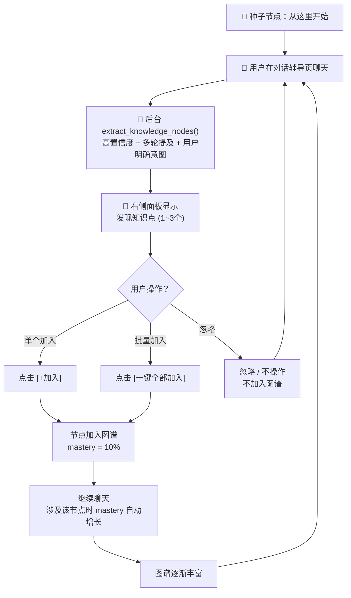

# 知识图谱页（Knowledge Graph）详细设计文档

> **文档类型**：布局逻辑设计（不含风格/配色）  
> **版本**：v1.0  
> **创建日期**：2026-07-14  
> **状态**：待用户确认  
> **依赖**：chat-page-layout-design.md（聊天页右侧面板已设计）

---

## 一、设计原则

```
从零开始 · 用户掌控 · 极简视觉 · 动态生长
─────────────────────────────────────────
· 没有骨架 JSON，只有一个种子节点
· 知识点仅通过对话提取，用户手动加入图谱
· 节点统一大小，仅靠掌握度改变单一颜色饱和度
· 所有连线统一样式
· 不展示 type / category / locked 状态
· 尽可能避免连线交叉
```

---

## 二、页面在系统中的位置

```
┌──────────────────────────────────────────────────────────────┐
│  Header（固定顶部 60px）                                      │
├────────┬─────────────────────────────────────────────────────┤
│        │                                                     │
│ Sidebar│            知识图谱页（本文件）                       │
│        │            router-view 渲染                        │
│        │                                                     │
└────────┴─────────────────────────────────────────────────────┘
```

**路由**：`/knowledge-graph`

**与聊天页的关系**：
- 聊天页右侧面板展示「发现知识点」列表
- 用户在聊天页点击 `[+加入]` → 节点即时加入图谱
- 切换到图谱页时，看到的是实时最新的图谱

---

## 三、页面全貌

```
┌──────────────────────────────────────────────────────────────┐
│                                                              │
│                                                              │
│                    [梯度下降]                                 │
│                       │                                      │
│          [过拟合]──[反向传播]──[CNN]                          │
│             │         │         │                            │
│          [ML基础]─────┼─────────┘                            │
│             │         │                                      │
│             │    [DL基础]                                    │
│             │                                                │
│          [从这里开始]                                         │
│                                                              │
│                                                              │
│                                                              │
│                                                              │
│  ┌──────────────────────────────────────────────────────┐   │
│  │ 8 个知识点  ·  最近加入：卷积层 (5分钟前)               │   │
│  └──────────────────────────────────────────────────────┘   │
└──────────────────────────────────────────────────────────────┘
```

**页面全屏沉浸**，图区撑满除底部栏外的所有空间。没有顶栏标题、没有浮动工具栏、没有筛选器。

---

## 四、图区（Graph Canvas）

### 4.1 布局

```
┌──────────────────────────────────────────────────────────────┐
│                                                              │
│                  全屏图区（flex: 1）                          │
│                                                              │
│              力导向图 · cytoscape.js                         │
│              布局算法：cose-bilkent                          │
│                                                              │
│              - 拖拽节点                                      │
│              - 滚轮缩放（max 3x / min 0.3x）                 │
│              - 按住空白平移                                   │
│              - 点击节点 → 详情面板                            │
│                                                              │
├──────────────────────────────────────────────────────────────┤
│  底部栏：h 36px                                              │
└──────────────────────────────────────────────────────────────┘
```

### 4.2 布局算法

使用 cytoscape.js 的 `cose-bilkent` 布局：

```
特点：
- 专为层级关系图（有向图）设计
- 比通用力导向更少交叉
- 天然支持 DAG（有向无环图）展开
- 支持父子层级对齐

配置要点：
- gravity: 适中的全局引力（防止散太开）
- nodeRepulsion: 较高的节点斥力（避免重叠）
- idealEdgeLength: 80-120px（连线长度适中）
- 父子层级间的垂直偏移
```

> 连线交叉不能 100% 消除（这是图论 NP 难问题），但 cose-bilkent 是已知交叉最少的实用算法之一。剩余交叉通过半透明连线降低视觉冲突。用户也可手动拖拽微调。

### 4.3 节点视觉规范

```
节点统一规格：
  - 形状：圆形
  - 直径：32px
  - 标签：节点下方 6px，12px regular

唯一视觉变量：颜色饱和度
  根据 mastery 0→100 线性映射
  mastery 0%  → 饱和度最低（几乎灰白）
  mastery 50% → 饱和度中等
  mastery 100% → 饱和度最高（但不艳丽，保持克制）

效果示例：
  mastery 0%     30%        60%        90%
     ○           ◑          ◔          ●
  极浅灰调      淡淡浅调     明显中调    饱满基调
```

**所有节点大小一致，不按难度变化**。一眼扫过去，颜色深的 = 掌握好的，颜色浅的 = 刚加入还没怎么学的。

### 4.4 连线规范

```
所有连线统一样式：
  线型：1.5px 实线
  无箭头
  不区分 depends_on / extends / parallel
  半透明，不抢节点视觉

hover 连线：
  → 显示 rationale 文字 tooltip
  → 连线加粗到 2px
```

### 4.5 种子节点

```
初始状态：图谱只有一个节点

                   ┌─────────────┐
                   │ 从这里开始    │
                   │             │
                   │ 点击查看     │
                   │ 知识图谱教程  │
                   └─────────────┘

规格：直径 40px（略大于普通节点）
标签：12px regular
内容：点击后弹出教程面板，介绍：
  - 知识图谱是什么
  - 节点如何加入（去聊天页对话）
  - 如何拖拽/缩放/平移
  - 节点颜色深浅的含义
```

---

## 五、交互行为

### 5.1 基础交互

| 操作 | 行为 |
|------|------|
| 滚轮 | 缩放画布（max 3x / min 0.3x），缩放中心 = 鼠标位置 |
| 按住画布空白处拖拽 | 平移画布 |
| 拖拽节点 | 节点跟随鼠标，连线弹性跟随。释放后停留在新位置 |
| hover 节点 | ① tooltip 显示 name + mastery ② 节点微微放大 1.08x ③ cursor→pointer |
| hover 连线 | 显示 rationale tooltip，连线加粗 |
| 点击节点 | **聚焦该节点**（见 5.2） |
| 点击画布空白 | 取消聚焦，恢复全貌 |
| 双击节点 | 聚焦更深入（仅显示 2 跳邻居，其余隐藏） |

### 5.2 点击节点 → 聚焦流程

```
点击节点 "CNN"
       │
       ▼
┌──────────────────────────┐
│ 1. 节点高亮               │  放大 1.15x + 外侧光环
│                          │
│ 2. 直接邻居（1 跳）保持   │  opacity 100%
│    其余节点淡化           │  opacity 25%
│    无关连线淡化           │  opacity 10%
│                          │
│ 3. 详情面板从右侧滑入     │  宽度 320px
│    图区缩窄 320px         │  动画 250ms ease
│                          │
│ 4. 加载节点详情           │  API: /api/knowledge-graph/{id}/nodes/{nodeId}
└──────────────────────────┘
```

**点击画布空白 → 取消聚焦 → 详情面板滑出 → 所有节点恢复 opacity 100%**

### 5.3 节点详情面板

```
┌─────────────────────────────────┐
│                         [✕]     │
│                                 │
│  ◉  CNN 卷积神经网络             │  ← 节点名，16px bold
│                                 │
│  ─────────────────────────────  │
│                                 │
│  📊 掌握度                      │
│  ████████████░░░░░░░░  45%     │  ← 进度条
│  复习 3 次  ·  上次 2 天前       │
│                                 │
│  📖 描述                        │
│  卷积层+池化层+全连接层的结构、   │
│  感受野、经典架构（LeNet/AlexNet │
│  /ResNet）及训练技巧             │
│                                 │
│  ─────────────────────────────  │
│                                 │
│  🔗 关联节点                    │
│  ┌───────────────────────────┐  │
│  │ DL基础 ── CNN              │  │  ← 每个关联节点可点击
│  │ CNN ── Transformer         │  │     点击后聚焦到该节点
│  │ 反向传播 ── CNN            │  │
│  └───────────────────────────┘  │
│                                 │
│  ─────────────────────────────  │
│                                 │
│  📎 快捷操作                    │
│  ┌─────────┐ ┌─────────┐      │
│  │ 📖 学这个 │ │ ✏️ 做题  │      │  跳转到资源中心 / 练习中心
│  └─────────┘ └─────────┘      │     绑定该知识点作为上下文
│  ┌─────────┐ ┌─────────┐      │
│  │ 💬 提问   │ │ 🗑 移除  │      │  提问：跳转对话页 + 绑定知识点
│  └─────────┘ └─────────┘      │  移除：仅从图谱移除（见 5.4）
│                                 │
└─────────────────────────────────┘

宽度：320px
动画：从右侧滑入，250ms ease
```

### 5.4 移除节点流程

```
用户点击 🗑 移除
       │
       ▼
┌──────────────────────────┐
│ 弹出确认弹窗              │
│                          │
│ "确定要将 [CNN] 从图谱中  │
│  移除吗？                 │
│  相关的连线也会被移除。"   │
│                          │
│ [取消]  [确认移除]        │
└────────┬─────────────────┘
         │ 点击确认
         ▼
┌──────────────────────────┐
│ 前端：节点从图谱移除       │  动画：缩小 + 淡出 200ms
│ 后端：标记 removed=true   │  （不物理删除，用户可恢复）
│ 连线：涉及该节点的边同时   │
│       移除                │
└──────────────────────────┘
```

> **【待确认 ①】** 移除后能否撤销/恢复？需要后端提供恢复接口吗？

---

## 六、底部信息栏

```
┌──────────────────────────────────────────────────────────────┐
│  8 个知识点  ·  最近加入：卷积层 (5分钟前)                     │
└──────────────────────────────────────────────────────────────┘

高度：36px
固定页面底部
内容：
  节点总数：实时统计
  最近加入：最后加入图谱的节点名 + 距今时间
刷新：每次节点变动时自动更新
```

---

## 七、聊天页右侧面板 — 知识点发现区

这是图谱生长的**唯一入口**。

### 7.1 面板位置

回顾聊天页设计文档（chat-page-layout-design.md）第七节，右侧面板展开 280px 时，知识点区域位于面板中段。

### 7.2 面板内容

```
┌──────────────────────────┐
│ 📋 会话面板               │  ← 面板标题
├──────────────────────────┤
│                          │
│ 📌 发现知识点 (2)         │  ← 本次对话提取的，尚未加入图谱
│ ┌──────────────────────┐ │
│ │ ◉ 最大池化            │ │
│ │   取窗口内最大值降采样  │ │
│ │               [+加入] │ │
│ └──────────────────────┘ │
│ ┌──────────────────────┐ │
│ │ ◉ Flatten层          │ │
│ │   将特征图展平为向量   │ │
│ │               [+加入] │ │
│ └──────────────────────┘ │
│                          │
│ ──────────────────────── │
│                          │
│ 🗺️ 已加入图谱 (5)         │  ← 本次对话中已加入图谱的
│ ┌──────────────────────┐ │
│ │ ██ 卷积层     60%    │ │  ← 带进度条
│ │ ██ 感受野     40%    │ │
│ │ ░░ Padding    10%    │ │
│ │ ░░ 步长        5%    │ │
│ │ ░░ 通道        0%    │ │
│ └──────────────────────┘ │
│                          │
│ [📊 一键全部加入]         │  ← 批量操作按钮
│                          │
└──────────────────────────┘
```

### 7.3 知识点提取与筛选

不是每次对话都提取节点。需要满足以下条件才出现在面板：

```
筛选规则（后端知识提取后，前端/后端二次过滤）：
  ✓ LLM confidence ≥ 0.9（高置信度）
  ✓ 同一知识点在对话中被提及 ≥ 2 轮（不是随口一提）
  ✓ 用户触发了解释/追问类意图（"XX是什么"、"解释一下XX"）

效果：
  → 一次对话通常产出 1~3 个高质量候选节点
  → 避免面板被垃圾节点淹没
```

### 7.4 加入图谱的交互

| 操作 | 行为 |
|------|------|
| 点击 `[+加入]` | 单个节点加入图谱，mastery 初始 10%，从「发现」移到「已加入」 |
| 点击 `[📊 一键全部加入]` | 所有「发现知识点」批量加入 |
| 用户对 AI 说"把卷积层加入知识图谱" | AI 自动触发加入（前端收到事件后更新面板） |

**用户始终掌握主动权**——不点击就不加入，不加入就不出现在图谱。

### 7.5 mastery 自动增长

已加入图谱的节点，在后续对话中涉及该知识点时，mastery 自动小幅增长：

```
规则：
  - 每次相关对话 +2~5%（由后端判定）
  - 完成该知识点的练习 +10~15%
  - mastery 上限 100%
  - 超过 30 天未复习 → mastery 缓慢衰减（-1%/天，最低回到 5%）
```

> **【待确认 ②】** mastery 增长和衰减规则是否需要细化？当前粗粒度够用吗？

---

## 八、完整生命周期



---

## 九、初始空状态

```
┌──────────────────────────────────────────────────────────────┐
│                                                              │
│                                                              │
│                                                              │
│                                                              │
│                   ┌─────────────┐                            │
│                   │ 从这里开始    │                            │
│                   └─────────────┘                            │
│                                                              │
│                                                              │
│                                                              │
│                去对话辅导页聊几句                              │
│                知识点就会出现在这里                             │
│                                                              │
│                                                              │
├──────────────────────────────────────────────────────────────┤
│  1 个知识点  ·  最近加入：从这里开始 (初次见面)                 │
└──────────────────────────────────────────────────────────────┘
```

---

## 十、图谱数据模型

```
Node（前端视角）:
  id: string              # 节点唯一ID（拼音hash）
  name: string            # 显示名
  description: string     # 描述
  mastery: number         # 掌握度 0-100
  difficulty: number      # 难度 1-5（后端保留，前端不用于视觉）
  sub_concepts: [...]     # 子概念列表

Edge:
  source: string          # 源节点ID
  target: string          # 目标节点ID
  rationale: string       # 关系说明（hover 显示）

注：
  type / category 字段后端仍会产出（LLM 提取需要），
  但前端完全不读取、不展示、不筛选。
```

---

## 十一、技术选型建议

| 方案 | 库 | 优势 |
|------|-----|------|
| 当前 | ECharts | 已集成 |
| **推荐** | **cytoscape.js** | 力导向更自然、cose-bilkent 布局交叉少、原生支持拖拽缩放、更接近 Obsidian 风格 |

> **【待确认 ③】** 是否切换到 cytoscape.js？迁移成本中等（ECharts 的 graph 组件 API 和 cytoscape 有差异），但视觉效果提升明显。

---

## 十二、待确认问题汇总

| 编号 | 问题 | 推荐方案 |
|------|------|---------|
| ① | 移除节点后能否撤销/恢复？ | 前端本地保留快照，刷新前可 Ctrl+Z 恢复 |
| ② | mastery 增长/衰减规则是否细化？ | 当前粗粒度够用，后续迭代 |
| ③ | 是否切换到 cytoscape.js？ | 推荐切换，连线交叉更少 |

---

## 十三、不在此文档范围内

- ❌ 配色 / 字体 / 阴影 / 渐变（用户自行决定）
- ❌ 后端 extract_knowledge_nodes 算法细节
- ❌ LLM prompt 工程
- ❌ Sidebar / 聊天页 / 其他页面设计（已有独立文档）

---

**下一步**：确认后进入编码实现。
