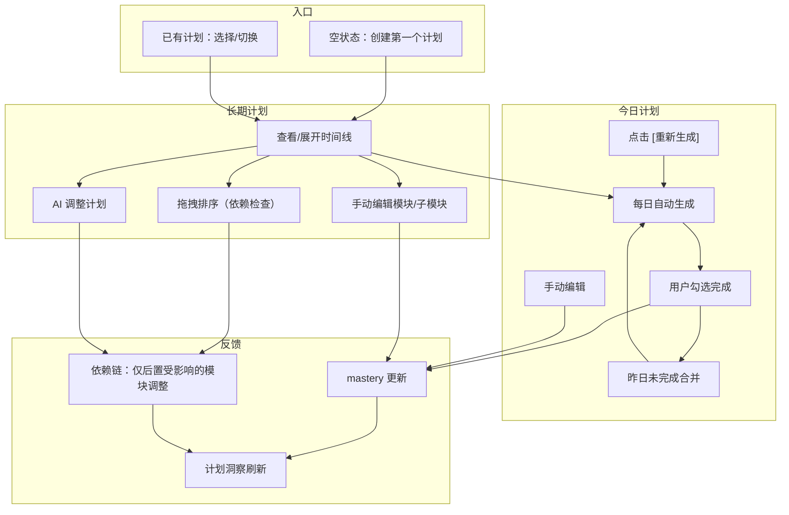

# 学习计划页（Learning Plan）详细设计文档

> **文档类型**：布局逻辑设计（不含风格/配色）  
> **版本**：v1.0  
> **创建日期**：2026-07-14  
> **状态**：待用户确认  
> **依赖**：knowledge-graph-layout-design.md（知识图谱联动）

---

## 一、设计原则

```
长期计划 + 每日拆解 + 外科手术式动态调整
─────────────────────────────────────────
· 一个计划 = 大模块 → 子模块 两级粒度
· 多个长期计划并存
· 每日自动生成今日计划（合并所有长期计划的任务）
· 只调整受影响的依赖链，不牵一发而动全身
· 三层（计划 / 大模块 / 子模块）全部可手动编辑
· 通过对话或 AI 按钮触发智能调整
```

---

## 二、页面在系统中的位置

```
┌──────────────────────────────────────────────────────────────┐
│  Header（固定顶部 60px）                                      │
├────────┬─────────────────────────────────────────────────────┤
│        │                                                     │
│ Sidebar│            学习计划页（本文件）                       │
│        │            router-view 渲染                        │
│        │                                                     │
└────────┴─────────────────────────────────────────────────────┘
```

**路由**：`/learning-plan`

---

## 三、页面全貌

```
┌──────────────────────────────────────────────────────────────┐
│                                                              │
│  当前计划：[AI 工程师学习路径 ▾]               [+ 新建计划]    │
│                                                              │
│  ╔══════════════════════════════════════════════════════════╗ │
│  ║  📅 今日计划 — 7月14日 周日                      [编辑]  ║ │
│  ║                                                        ║ │
│  ║  ☐  复习监督学习与无监督学习的概念区别   📖 30min  ML基础 ║ │
│  ║  ☐  完成模型评估章节的阅读              📄 45min  ML基础 ║ │
│  ║  ☐  练习 10 道交叉验证题               ✏️ 25min  ML基础 ║ │
│  ║  ☐  阅读 Transformer 架构概述           📄 20min  DL专项 ║ │
│  ║                                                        ║ │
│  ║  预计 2h  ·  来自 2 个计划                               ║ │
│  ║                                                        ║ │
│  ║  [✏️ 手动添加]   [🔄 重新生成]   [✓ 全部完成]           ║ │
│  ╚══════════════════════════════════════════════════════════╝ │
│                                                              │
│  ┌────────────────────────────────────────────────────────┐  │
│  │ 🗺️ 长期计划：AI 工程师学习路径                         │  │
│  │                                                        │  │
│  │ ████████████████████████████░░░░░░░░  65%               │  │
│  │ 12 模块  ·  8 已完成  ·  预计 12 周  ·  连续学习 14 天   │  │
│  │                                                        │  │
│  │ [📋 仅看未完成]  [🔽 全部折叠]  [🔄 AI 调整计划]        │  │
│  └────────────────────────────────────────────────────────┘  │
│                                                              │
│  ● Python 基础                                    ✅ 已完成  │
│  │                                                           │
│  ● 数学基础                                       ✅ 已完成  │
│  │                                                           │
│  ◉ 机器学习入门                                   ▶️ 进行中  │
│  │  60%  ·  还剩约 4 小时                                    │
│  │  ┌──────────────────────────────────────────────────┐    │
│  │  │ ✅ 监督学习                        📄 文档  ✏️ 练习│    │
│  │  │ ✅ 无监督学习                       📄 文档  ✏️ 练习│    │
│  │  │ ▶️ 模型评估                        📄 文档         │    │
│  │  │ ○  特征工程                                        │    │
│  │  │ [+ 添加子模块]                                     │    │
│  │  └──────────────────────────────────────────────────┘    │
│  │  [▶️ 继续学习]  [✎ 重命名]  [⏩ 跳过]  [🗑 删除]        │
│  │                                                           │
│  ○ 深度学习                                      🔒 待解锁  │
│  │  预计 20h  ·  6 子模块                                    │
│  │                                                           │
│  ○ NLP 专项                                       🔒 待解锁  │
│  │                                                           │
│  ○ 项目实战                                       🔒 待解锁  │
│  │                                                           │
│  │  [+ 添加模块]                                             │
│  │                                                           │
│  ┌────────────────────────────────────────────────────────┐  │
│  │ 💡 计划洞察                                           │  │
│  │ · ⚠️ 数学基础 14 天未复习，掌握度 90%→55%，建议重温    │  │
│  │ · 📈 按当前节奏，预计比原计划提前 3 天                  │  │
│  │ · 🔗 知识图谱新增「注意力机制」节点，可加入 NLP 模块     │  │
│  └────────────────────────────────────────────────────────┘  │
│                                                              │
└──────────────────────────────────────────────────────────────┘
```

---

## 四、逐区域分解

### 4.1 计划选择器

```
当前计划：[AI 工程师学习路径 ▾]               [+ 新建计划]

下拉展开：
┌────────────────────────────┐
│ AI 工程师学习路径     65%   │  ← 当前选中 ✓
│ 12 模块 · 8 已完成          │
├────────────────────────────┤
│ 数据分析师学习路径    30%   │
│ 6 模块 · 2 已完成           │
├────────────────────────────┤
│ Python 进阶专项       10%   │
│ 4 模块 · 0 已完成           │
├────────────────────────────┤
│ [+ 新建计划...]             │
└────────────────────────────┘

规格：下拉宽度 280px
每个计划项显示：名称 + 进度条 + 模块统计
```

### 4.2 今日计划面板

```
╔══════════════════════════════════════════════════════════════╗
║  📅 今日计划 — 7月14日 周日                         [编辑]   ║
║                                                              ║
║  ☐  复习监督学习与无监督学习的区别        📖 30min   ML基础   ║
║  ☐  完成模型评估章节的阅读                📄 45min   ML基础   ║
║  ☐  练习 10 道交叉验证题                 ✏️ 25min   ML基础   ║
║  ☐  阅读 Transformer 架构概述             📄 20min   DL专项   ║
║                                                              ║
║  ─────────────────────────────────────────────────────────── ║
║  预计 2h  ·  共 4 项  ·  来自 2 个计划                         ║
║                                                              ║
║  [✏️ 手动添加]    [🔄 重新生成]    [✓ 全部完成]               ║
╚══════════════════════════════════════════════════════════════╝

位置：长期计划时间线上方
高度：自适应（4~8 条任务约 280px）
圆角：16px
```

**每条任务行的结构**：

```
☐  复习监督学习与无监督学习的区别        📖 30min   ML基础
──  ─────────────────────────────        ── ─────   ──────
勾选  任务名称（可 inline 编辑）         类型 时长    来源模块
框

类型图标：📖 阅读 / ✏️ 练习 / 🎬 视频 / 💬 对话 / 📝 笔记
时长：可点击修改（弹出数字输入）
来源模块：显示所属模块简称，点击可跳转到时间线对应位置
```

**勾选完成**：

```
☑  复习监督学习与无监督学习的区别        📖 30min   ML基础
    ────────────────────────────────────────────
    文字划线 + 微微淡化

效果：
  → 长期计划中对应子模块 mastery 立即 +3%
  → 对应模块进度重新计算
  → 底部「已完成」计数 +1
```

**编辑模式**（点击 [编辑] 按钮）：

```
╔══════════════════════════════════════════════════════════════╗
║  📅 今日计划 — 7月14日 周日                         [完成]   ║
║                                                              ║
║  ☐  复习监督学习与无监督学习的区别        📖 [30]min  ML基础  ║
║  ☐  完成模型评估章节的阅读                📄 [45]min  ML基础  ║
║  ☐  练习 10 道交叉验证题                 ✏️ [25]min  ML基础  ║
║  ─ ─ ─ ─ ─ ─ ─ ─ ─ ─ ─ ─ ─ ─ ─ ─ ─ ─ ─ ─ ─ ─ ─ ─ ─ ─ ─ ║
║  ☐  阅读 Transformer 架构概述             📄 [20]min  DL专项  ║
║                                                              ║
║  拖拽 ⠿ 调整排序  ·  点击 ❌ 删除任务  ·  点击文字修改任务名    ║
║                                                              ║
║  [+ 添加一行]   [🔄 重新生成]                                ║
╚══════════════════════════════════════════════════════════════╝

编辑模式下：
  - 任务名可 inline 编辑
  - 时长显示为输入框，可修改
  - 左侧出现 ⠿ 拖拽手柄，支持拖拽排序
  - 右侧出现 ❌ 删除按钮
  - [✏️ 手动添加] 变为 [+ 添加一行]
```

**今日计划生成逻辑**：

```
每天首次打开页面 → 自动调用今日计划 Agent：

输入：
  · 用户所有活跃计划的所有未完成模块
  · 各模块当前 mastery / 进度
  · 昨日今日计划的完成情况
  · 半衰期复习提醒（哪些知识点该复习了）
  · 默认容量：每天 2h

输出：4~8 条今日任务
  每条：任务名 + 类型 + 预估时长 + 来源模块

优先策略：
  1. 优先安排半衰期到期需复习的模块
  2. 其次安排当前正在进行的模块
  3. 同一模块的子任务尽量连续排列
  4. 任务时长总和控制在 2h 以内

合并规则：
  多个计划的任务合并到同一份今日计划
  每条任务标注来源计划/模块
```

**昨日未完成处理**：

```
今天打开页面，昨天有 2 条未勾选：

╔══════════════════════════════════════════════════════════════╗
║  📅 今日计划 — 7月15日 周一                                  ║
║                                                              ║
║  ── 昨日未完成 ──────────────────────────────────────────── ║
║  ⚠️ 完成模型评估章节的阅读                📄 45min   ML基础   ║
║  ⚠️ 练习 10 道交叉验证题                 ✏️ 25min   ML基础   ║
║  ── 今日推荐 ────────────────────────────────────────────   ║
║  ☐  学习特征工程基础                     📄 30min   ML基础   ║
║  ☐  阅读 Attention 机制详解              📄 40min   DL专项   ║
║                                                              ║
║  昨天 2 项未完成，已自动合并到今天                            ║
╚══════════════════════════════════════════════════════════════╝

未完成任务的标记 ⚠️，与今日新任务用分隔线区分
未完成任务的来源模块：
  → 检查依赖链：只有被它阻塞的后置模块受影响
  → 不阻塞的模块保持原计划
```

### 4.3 长期计划时间线

**统计概览条**：

```
┌────────────────────────────────────────────────────────────┐
│ 🗺️ 长期计划：AI 工程师学习路径                             │
│                                                            │
│ ████████████████████████████░░░░░░░░░░  65%                │
│ 12 模块  ·  8 已完成  ·  预计 12 周  ·  连续学习 14 天       │
│                                                            │
│ [📋 仅看未完成]  [🔽 全部折叠]  [🔄 AI 调整计划]            │
└────────────────────────────────────────────────────────────┘

高度：自适应约 100px
padding：20px
圆角：16px

按钮说明：
  📋 仅看未完成 → 折叠所有已完成模块，只显示进行中+待解锁
  🔽 全部折叠 → 所有模块只显示标题行，不展开子模块
  🔄 AI 调整计划 → 调用后端 AdjustmentAgent
```

**时间线节点**：

```
  ● ──── Python 基础                                    ✅ 已完成
  │
  ● ──── 数学基础                                       ✅ 已完成
  │
  ◉ ──── 机器学习入门                                   ▶️ 进行中
  │      ...子模块区域...
  │
  ○ ──── 深度学习                                      🔒 待解锁
  │
  ○ ──── NLP 专项                                     🔒 待解锁
  │
  [+ 添加模块]

节点规格：
  ● 已完成：直径 24px，实心
  ◉ 进行中：直径 28px，略大突出
  ○ 待解锁：直径 24px，空心
  连线：已完成段实线，待解锁段虚线
```

**模块卡片 — 已完成（折叠态）**：

```
● Python 基础                                       ✅ 已完成
  掌握 Python 编程语言的基本语法和常用库

  [📖 复习]    [📊 展开详情 ▾]

hover 可展开：
● Python 基础                                       ✅ 已完成
  掌握 Python 编程语言的基本语法和常用库
  ┌──────────────────────────────────────────────────┐
  │ ✅ 变量与数据类型                    📄 文档      │
  │ ✅ 函数与模块                        📄 文档      │
  │ ✅ 面向对象编程                      📄 文档  ✏️ │
  └──────────────────────────────────────────────────┘

已完成模块不可「继续学习」（已完成），但可以复习
```

**模块卡片 — 进行中**：

```
◉ 机器学习入门                                     ▶️ 进行中
  理解 ML 核心概念与经典算法  ·  60%  ·  已学 6h / 总 10h

  ████████████████░░░░░░░░  60%

  ┌─────────────────────────────────────────────────────┐
  │ ✅ 监督学习                          📄 文档  ✏️ 练习│
  │ ✅ 无监督学习                         📄 文档  ✏️ 练习│
  │ ▶️ 模型评估                          📄 文档          │
  │ ○  特征工程                                            │
  │                                             [+ 添加]  │
  └─────────────────────────────────────────────────────┘

  [▶️ 继续学习]   [📊 自测一下]   [✎ 重命名]   [⏩ 跳过]   [🗑 删除]

操作说明：
  ▶️ 继续学习 → 根据当前子模块类型跳转对应页面
  📊 自测 → 生成该模块的练习，检验掌握度
  ✎ 重命名 → inline 编辑模块标题
  ⏩ 跳过 → 标记为已完成，解锁后续模块（用户确认后执行）
  🗑 删除 → 删除整个模块（用户确认，不可恢复）
```

**模块卡片 — 待解锁**：

```
○ 深度学习                                         🔒 待解锁
  学习神经网络与深度学习的核心原理  ·  预计 20h  ·  6 子模块

  前置依赖：机器学习入门（进行中）

  完成前置模块后自动解锁
```

### 4.4 三级编辑能力

| 层级 | 可操作项 |
|------|---------|
| **计划** | 重命名 / 删除 / AI 调整 / 新建 |
| **大模块** | 重命名 / 删除 / 跳过 / 拖拽排序 / 添加子模块 / AI 调整此模块 |
| **子模块** | 重命名 / 删除 / 关联资源 / 拖拽排序 / 修改类型 |

**拖拽排序**：

```
拖拽模块 → 计算是否与依赖链冲突：

  拖拽「NLP 专项」到「深度学习」前面 →
    检查：NLP 是否依赖 DL？
      → 不依赖 → 直接交换 ✓
      → 依赖 → 红线提示：⚠️ 不能放在依赖项之前 [取消]

  拖拽子模块「特征工程」到「模型评估」前面 →
    检查：子模块之间无强依赖（它们平级）→ 直接交换 ✓
```

### 4.5 AI 调整计划

```
用户点击 [🔄 AI 调整计划] / 在对话中对 AI 提出调整需求：

示例输入："我 8 月要去实习一个月，没时间学"

       │
       ▼
┌──────────────────────────────────────────┐
│ 调用后端 AdjustmentAgent                    │
│                                            │
│ 📋 AI 调整预览                              │
│ ┌────────────────────────────────────────┐ │
│ │ ⏸️ 8月1日 ~ 8月31日：暂停学习          │ │
│ │                                        │ │
│ │ 📉 预计衰减的模块：                     │ │
│ │   机器学习入门  60% → 35%              │ │
│ │   数学基础      90% → 55%              │ │
│ │   Python 基础   95% → 80%             │ │
│ │                                        │ │
│ │ 🔄 恢复后自动插入复习节点：              │ │
│ │   9月1日 数学基础复习 (1h)             │ │
│ │   9月2日 机器学习快速回顾 (2h)         │ │
│ │                                        │ │
│ │ 📅 原计划完成日：9月15日                │ │
│ │    调整后完成日：10月20日               │ │
│ └────────────────────────────────────────┘ │
│                                            │
│ [应用调整]    [取消]                        │
└────────────────────────────────────────────┘
```

**外科手术式原则**：只调整受影响的依赖链。

```
暂停一个月后：
  → 所有模块的 mastery 按半衰期计算衰减
  → 「机器学习入门」未完成 → 其直接后继「深度学习」解锁推迟
  → 「NLP 专项」独立路径 → 不受影响 → 原计划不变
  → 只插入必要的复习节点，不做全局重排
```

### 4.6 计划洞察区

```
┌────────────────────────────────────────────────────────────┐
│ 💡 计划洞察                                               │
│                                                            │
│ ⚠️ 数学基础已 14 天未复习，掌握度从 90% 衰减至 55%，         │
│    今日计划已自动插入复习任务                               │
│                                                            │
│ 📈 按当前节奏，预计比原计划提前 3 天完成                     │
│                                                            │
│ 🔗 知识图谱新增了「注意力机制」节点，                         │
│    建议加入 NLP 专项模块的子任务    [一键加入]              │
└────────────────────────────────────────────────────────────┘

高度：自适应约 100px
padding：20px
圆角：14px
每条一行：左侧图标 + 文字 + 可选的右侧操作按钮
```

---

## 五、与知识图谱的联动

```
计划中的子模块 → 对应知识图谱节点

时间线模块旁可显示「📊 查看图谱位置」：
  → 跳转到知识图谱页，聚焦到该知识点节点
  → 显示前置依赖 + 后置延伸

计划洞察中：知识图谱新增节点 → 推荐加入对应模块的子任务
  → 点击 [一键加入] → 在该模块下自动添加子模块
```

---

## 六、完整交互流程



---

## 七、空状态

```
进入学习计划页（无任何计划时）：

┌──────────────────────────────────────────────────────────────┐
│                                                              │
│                                                              │
│                           🗺️                                 │
│                     还没有学习计划                             │
│                                                              │
│              告诉我你想学什么，AI 帮你规划                      │
│                                                              │
│         ┌──────────────────────────────────────┐            │
│         │ 📝 我想成为 AI 工程师...              │            │
│         │                                      │            │
│         │ [✨ 生成学习计划]                      │            │
│         └──────────────────────────────────────┘            │
│                                                              │
│         或者从快捷方向开始：                                   │
│                                                              │
│         ┌────────────┐ ┌────────────┐ ┌────────────┐       │
│         │ 🤖 AI 工程   │ │ 📊 数据科学 │ │ 🎯 计算机   │       │
│         │ 师方向      │ │ 方向       │ │ 视觉方向   │       │
│         └────────────┘ └────────────┘ └────────────┘       │
│         ┌────────────┐ ┌────────────┐                       │
│         │ 🗣️ NLP     │ │ 🔧 ML 工程  │                       │
│         │ 方向       │ │ 方向       │                       │
│         └────────────┘ └────────────┘                       │
│                                                              │
└──────────────────────────────────────────────────────────────┘

快捷方向卡片：h 80px, w 160px, r12px
点击 → 自动填入输入框对应文字
点击 [✨ 生成学习计划] → 调用 PlanCenter (GoalAgent→DecomposeAgent→ScheduleAgent)
```

---

## 八、数据模型

```
Plan:
  id: number
  title: string                    # "AI 工程师学习路径"
  description: string
  status: "in_progress" | "completed" | "paused"
  progress: number                 # 0~100
  created_at: datetime
  estimated_weeks: number          # 12
  modules: Module[]

Module:
  id: number
  plan_id: number
  title: string                    # "机器学习入门"
  description: string
  status: "pending" | "in_progress" | "completed" | "locked"
  progress: number                 # 0~100
  order: number                    # 排序
  estimated_hours: number          # 10
  difficulty: number               # 1~5
  mastery_current: number          # 0~100
  review_count: number
  last_reviewed_at: datetime | null
  depends_on: number[]             # 依赖的 module_id 列表
  sub_modules: SubModule[]

SubModule:
  id: number
  module_id: number
  title: string                    # "监督学习"
  type: "learn" | "practice"
  status: "pending" | "in_progress" | "completed"
  order: number
  resource_links: ResourceLink[]

ResourceLink:
  type: "document" | "exercise" | "video" | "chat" | "note"
  id: string
  name: string

DailyPlan:
  date: date
  tasks: DailyTask[]

DailyTask:
  id: number
  title: string
  source_plan_id: number
  source_module_id: number
  source_sub_module_id: number | null
  resource_type: string
  estimated_minutes: number
  completed: boolean
  completed_at: datetime | null
  carried_from: date | null        # 从哪天遗留
```

---

## 九、待确认问题

> **【待确认 ①】** 今日计划的 Agent 是新增一个独立 Agent（如 DailyPlanAgent），还是复用现有的 ScheduleAgent？推荐新增，职责单一。

> **【待确认 ②】** 今日计划 Agent 什么时候触发？每天首次打开学习计划页时、还是每天凌晨定时生成？推荐首次打开页面时触发。

> **【待确认 ③】** 「仅看未完成」和「全部折叠」两个筛选按钮是否需要持久化用户的选择？

---

## 十、不在此文档范围内

- ❌ 配色 / 字体 / 阴影 / 渐变（用户自行决定）
- ❌ 后端 Agent 实现细节
- ❌ 今日计划 Agent prompt 设计
- ❌ 半衰期算法公式（已有 plan_service.py）
- ❌ Sidebar / 其他页面设计（已有独立文档）

---

**下一步**：确认后进入编码实现。
